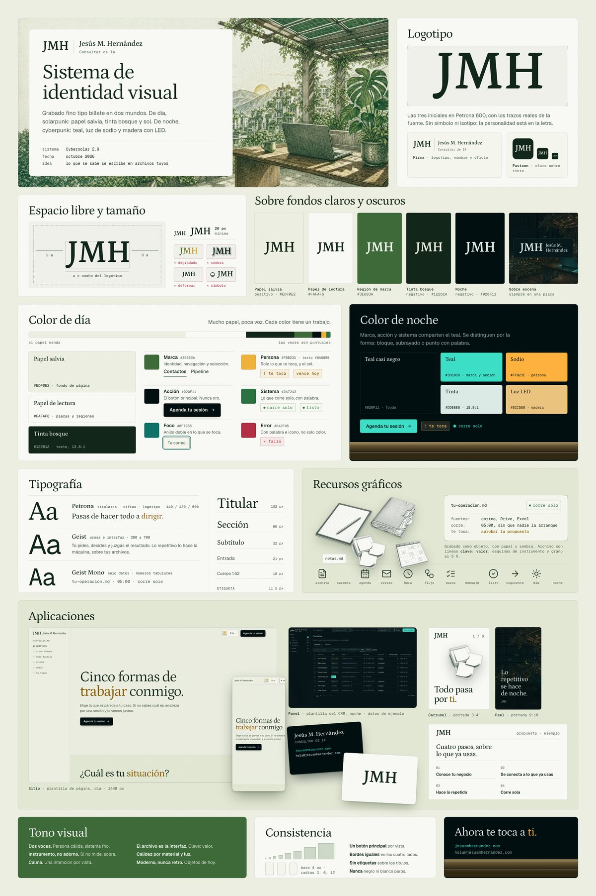

# Brand Identity Poster: a skill for Claude

A skill that turns a brand's **real** logo and assets into a client-ready
**brand identity poster** (a brand guideline board): logo and variants, clear
space, logo on light and dark backgrounds, color in use, typography, graphic
elements, icons, application mockups and tone, on one vertical board.

It produces a self-contained `poster.html` (scales to any screen), a
`poster.png` (2400 × 3600), a one-page `poster.pdf`, and a `brand-brief.md`
with the analysis and every decision behind the board.



More examples, made by the skill in tests with fictional brands:
[Olmo](examples/olmo-derive.jpg), a bakery with only a logo (Derive mode), and
[Tidewell](examples/tidewell-codify.jpg), a software company with tokens, rules
and site copy (Codify mode).

---

## Why use it (the difference)

Ask a model for a "premium brand guidelines board" and you usually get one of two
things: an **invented identity** (a symbol the brand never had, a palette picked
by mood, "+300 % growth" stats), or a **broken board** (text spilling out of
cards, a list clipped at the bottom, fallback fonts in the PDF, a table of hex
codes nobody can judge).

| | Without the skill | With Brand Identity Poster |
|---|---|---|
| Source of the identity | guessed from the prompt | the brand's real files; derivations written down |
| Logo | often retyped or redrawn | the real file, recolored only through masks |
| Color | a table of hex codes | each color with its role, contrast and a live component |
| Mockups | fake browser dots, phone bezels, lorem ipsum | built from the brand's tokens and real copy |
| Layout defects | found by the client | found by an automatic audit on every render |
| Deliverables | one image | HTML, PNG, PDF and a written brief |

It has two modes, chosen from what you give it:

- **Codify.** Your brand already has a system (tokens, a CSS file, a brand PDF, a
  `manifest.json` from [design-system-forge](https://github.com/hackeryisus/design-system-forge)).
  The skill presents it faithfully, and your rules win over generic advice.
- **Derive.** You only have a logo. The skill samples the palette from it, pairs
  fonts to its letterforms, and builds graphic elements only from the logo's real
  geometry. Every derivation is written in the brief as a proposal.

---

## Install

### Claude Code

Clone it into your skills folder:

```bash
git clone https://github.com/hackeryisus/brand-identity-poster.git ~/.claude/skills/brand-identity-poster
```

Then ask Claude something like *"make a brand guidelines board from the logo in
./brand/logo.svg"*.

### Claude.ai (Pro, Max, Team, Enterprise, with code execution on)

Download this repository as a `.zip` (Code → Download ZIP) and upload it as is,
without unzipping, under **Settings → Skills**.

### Requirements

- Python 3. Pillow is optional (`pip install pillow`) and enables image resizing
  and per-block crops.
- A Chromium browser for rendering: Chrome, Chromium, Edge or Brave. Set
  `BROWSER_BIN` if it lives somewhere unusual.
- Optional: Poppler (`pdfinfo`, `pdffonts`) to verify the PDF's page count and
  embedded fonts.
- Internet for Google Fonts and Lucide icons, unless you embed your own files.

---

## How it works

1. **Gather what is real.** The logo (SVG best, PNG with transparency fine), the
   language, the purpose, and any existing system, copy and imagery.
2. **Write the brief first.** Analysis (form, personality, audience, sector,
   tone, direction), decisions, what is given versus derived, conflicts, and a
   map of the board.
3. **Build** from a neutral 12-column template. `scripts/build.py` inlines the
   logo, images, fonts and Lucide icons into one self-contained HTML file.
4. **Render and audit** with `scripts/render.py`: PNG, PDF, one crop per block,
   a 65 % "glance" image, and a report of overflow, clipped content, fonts that
   failed, broken images, leftover placeholders, tiny text and horizontal scroll.
5. **Iterate** until the audit is clean and the checklist passes, then deliver.

```
brand-identity-poster/
├── SKILL.md                    workflow and craft rules
├── scripts/build.py            placeholders → one self-contained HTML
├── scripts/render.py           PNG + PDF + audit (works on any HTML)
├── scripts/contrast.py         WCAG contrast ratios for the palette
├── assets/template.html        neutral 2400 × 3600 scaffold, 12 blocks
├── references/brand-analysis.md   reading a system, deriving palette and type
├── references/blocks.md        what each block must show, and its pitfalls
├── references/checklist.md     final QA
└── examples/                   sample boards
```

---

## Credits

- Anti-pattern list adapted from [Hallmark](https://github.com/Nutlope/hallmark).
- Icons: [Lucide](https://lucide.dev) (ISC license), fetched at build time.
- Pairs well with [design-system-forge](https://github.com/hackeryisus/design-system-forge):
  that skill extracts a design system from references; this one presents it.

Made by [Jesús M. Hernández](https://www.jesusmhernandez.com), AI consultant.
MIT license.
